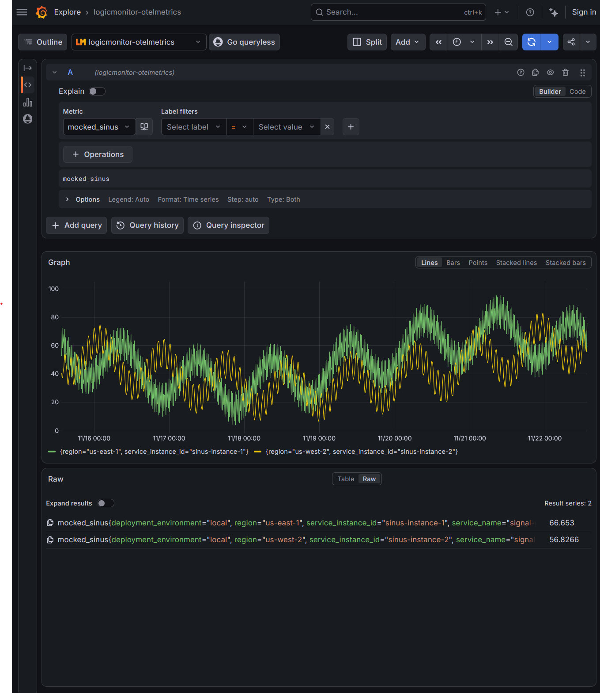
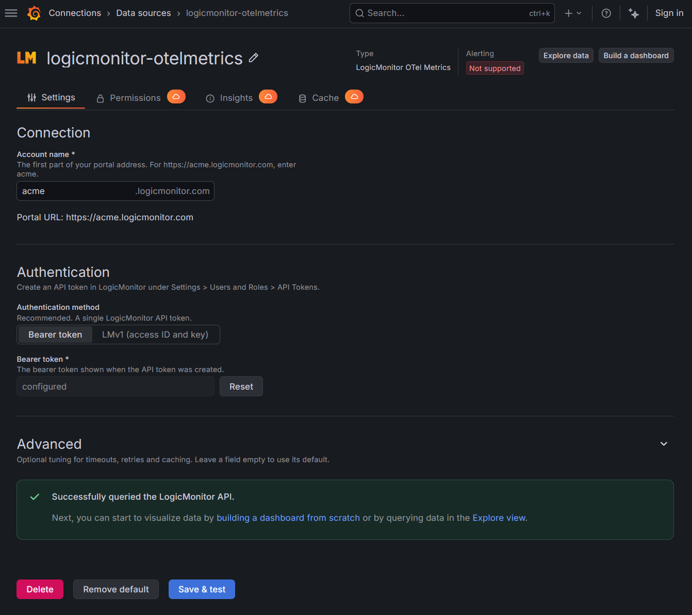

# LogicMonitor OTel Metrics data source for Grafana

Query [LogicMonitor](https://www.logicmonitor.com/) OpenTelemetry metrics in Grafana with PromQL. This backend
data source plugin exposes the LogicMonitor OTel Metrics API as a Prometheus-compatible data source, so you can use
the familiar Prometheus query editor, metrics browser, Explore and dashboards.

> [!IMPORTANT]
> **🛠️ Managed & Supported by [Monitoring Artist](https://monitoringartist.com)**
>
> This Grafana plugin is an independent, community-driven innovation by [Monitoring Artist](https://monitoringartist.com).
>
> **Official Support Disclaimer:** This project is not an official LogicMonitor product and is not covered by
> LogicMonitor’s standard support tiers.
>
> **Need Enterprise-Grade Reliability?** [Monitoring Artist](https://monitoringartist.com) provides professional
> implementation, custom feature development, and dedicated support for this integration. Partner with us for expert
> solutions.

## Features

- PromQL instant and range queries with the standard Prometheus query editor (builder and code mode), query help
  cheat sheet and the **Min interval** query option, in dashboards and Explore.
- Metric name, label name, label value and metric metadata discovery for the metrics browser, autocomplete, template
  variables and ad hoc filters. Series lookups (`/api/v1/series`) are supported with the semantics described in
  [Limitations](#limitations).
- Long time ranges: LogicMonitor limits a single request to a 30-day range, so the plugin splits longer range queries
  and metadata requests into 25-day chunks, runs them in parallel and merges the results in order.
- Bearer token or LMv1 (access ID and access key, HMAC-SHA256 signed) authentication.
- Configurable LogicMonitor API timeout that covers all chunks of a long query.
- Rate-limit aware: honors LogicMonitor's `X-Rate-Limit-*` headers, throttles new requests when the remaining quota
  is used up and retries a `429` only when the rate-limit window resets soon.
- Automatic retries for `502`, `503` and `504` responses and transient network errors, with backoff.
- Metadata cache: metric name, label and label value responses are cached per data source, and identical concurrent
  requests share a single LogicMonitor call. Errors are never cached.
- Configurable concurrency, retry, rate-limit and metadata cache limits.
- Private data source connect (PDC) / secure SOCKS proxy support when enabled in Grafana.

## Screenshots

### Explore query editor



### Data source configuration



## Limitations

- **No alerting:** the plugin does not declare alerting support, so it can't be used as a query source for Grafana
  alert rules. LogicMonitor has no Prometheus ruler or Alertmanager, so data source-managed alert and recording rules
  aren't available either. The recording rule settings inherited from Prometheus are removed.
- **No annotations:** the data source can't be used for annotation queries.
- **No exemplars:** the LogicMonitor API doesn't provide exemplars, so the query editor has no Exemplars option and
  the data source has no exemplar settings.
- **No search API:** the Prometheus `/api/v1/search/*` endpoints aren't supported.
- **Series semantics:** `/api/v1/series` runs an instant query for each `match[]` selector at the end of the
  requested time range. It returns only series that have a value at that time, not every series that existed during
  the range.
- **Range limit:** a single query or metadata request can cover at most 100 chunks of 25 days (about 6.8 years).
- **Response size:** a single LogicMonitor response is limited to 16 MiB.
- The plugin always connects to `https://<account>.logicmonitor.com`; custom URLs and other Prometheus servers aren't
  supported.
- Build info is synthetic; Prometheus features detected from it may not match what LogicMonitor supports.

## Requirements

- Grafana 12.3.0 or later.
- A LogicMonitor portal with OpenTelemetry metrics.
- A LogicMonitor API token: either a bearer token or an LMv1 access ID and access key.

## Installation

1. Download the plugin archive from the
   [GitHub releases](https://github.com/monitoringartist/monitoringartist-logicmonitorotelmetrics-datasource/releases),
   or build it yourself (see [Development and build](#development-and-build)).
2. Extract it into your Grafana plugins directory, for example `/var/lib/grafana/plugins`.
3. If the plugin is unsigned (for example a local build), allow it in `grafana.ini`:

   ```ini
   [plugins]
   allow_loading_unsigned_plugins = monitoringartist-logicmonitorotelmetrics-datasource
   ```

   or with the environment variable
   `GF_PLUGINS_ALLOW_LOADING_UNSIGNED_PLUGINS=monitoringartist-logicmonitorotelmetrics-datasource`.

4. Restart Grafana.

With the Grafana CLI:

```bash
grafana cli --pluginUrl <plugin-zip-url> plugins install monitoringartist-logicmonitorotelmetrics-datasource
```

## Configuration

Go to **Connections > Data sources > Add new data source** and select **LogicMonitor OTel Metrics**.

### Connection

- **Account name** (`jsonData.account`, required): the first part of your portal address. For
  `https://acme.logicmonitor.com`, enter `acme`. Use only lowercase letters, numbers and hyphens, without a leading or
  trailing hyphen; full URLs and domains are rejected. When the account is valid, the editor shows the resulting
  portal URL.

Data sources created by earlier plugin versions that stored the portal as `jsonData.portal` or as the data source URL
(`acme.logicmonitor.com` or `https://acme.logicmonitor.com`) are read as account `acme` until an account is saved.

### Authentication

Create an API token in LogicMonitor under **Settings > Users and Roles > API Tokens**, preferably for an API-only
user. The user's role needs read access to the OpenTelemetry metrics (and the resources that report them) that you
want to query in Grafana; the plugin only reads data.

- **Authentication method** (`jsonData.authType`): `bearer` (recommended) or `lmv1`. If it isn't set, the method is
  inferred from the configured credentials, preferring a bearer token.
- **Bearer token** (`secureJsonData.token`, required for bearer): the bearer token shown when the API token was
  created. A leading `Bearer ` prefix is removed.
- **Access ID** (`jsonData.accessId`, required for LMv1): the access ID of the LMv1 API token.
- **Access key** (`secureJsonData.accessKey`, required for LMv1): the access key of the LMv1 API token. Requests are
  signed with the LMv1 HMAC-SHA256 scheme.

Tokens and access keys are stored encrypted in `secureJsonData`.

### Advanced

The collapsible **Advanced** section holds optional tuning. Leave a field empty to use its default. The editor accepts
whole numbers within the range shown. When provisioned values are outside the range, the backend clamps them to the
nearest bound, except **Timeout**, which falls back to its default. Invalid values use the default.

| Group                     | Setting              | jsonData key              | Default | Range    | Description                                                                                        |
| ------------------------- | -------------------- | ------------------------- | ------- | -------- | -------------------------------------------------------------------------------------------------- |
| Requests                  | Timeout              | `lmTimeout`               | 60 s    | 1–600 s  | Time allowed for each LogicMonitor API call, including all chunks of a long time range.            |
| Requests                  | Parallel chunks      | `queryRangeWorkers`       | 10      | 1–50     | Number of 25-day chunks of one long query or metadata request fetched in parallel.                 |
| Requests                  | Concurrent requests  | `maxConcurrentRequests`   | 16      | 1–100    | LogicMonitor API requests this data source can have in flight at once.                             |
| Retries and rate limiting | Attempts per request | `maxRetryAttempts`        | 3       | 1–10     | Attempts per request, including the first, for `429`, `502`/`503`/`504` and network errors.        |
| Retries and rate limiting | Rate-limit wait      | `maxRateLimitWaitSeconds` | 2 s     | 1–30 s   | Longest wait for the rate-limit window to reset. Requests that would wait longer fail immediately. |
| Metadata cache            | Cache TTL            | `cacheTTLSeconds`         | 60 s    | 1–3600 s | How long metric name, label and label value responses are cached.                                  |
| Metadata cache            | Cache size           | `cacheMaxEntries`         | 1000    | 1–100000 | Maximum number of cached metadata responses.                                                       |

### Rate limiting

LogicMonitor reports its API rate limit in the `X-Rate-Limit-Limit`, `X-Rate-Limit-Remaining` and
`X-Rate-Limit-Window` response headers. The plugin tracks these headers from every response, shared by all queries of
the data source. When no requests remain in the current window, new requests (including parallel chunks of long
queries) wait until the window resets, for at most the rate-limit wait.

A `429` response is retried after its `Retry-After` delay (up to 10 seconds) or, when the headers show no remaining
requests and a window no longer than the rate-limit wait, after that window. Otherwise the request fails fast with
`LogicMonitor returned 429; rate-limit headers do not indicate availability within Ns`. A `429` on the last attempt
fails with `LogicMonitor returned 429 after N attempts`.

### Private data source connect (PDC)

When Grafana has the secure SOCKS proxy enabled (for example on Grafana Cloud with
[private data source connect](https://grafana.com/docs/grafana-cloud/connect-externally-hosted/private-data-source-connect/)),
the configuration page shows the **Secure Socks Proxy** settings. Enable them to route LogicMonitor API requests
through the proxy.

### Provisioning

Replace the placeholder values. `account` is only the account name. The same examples are in
[`provisioning/datasources/datasources.yml`](https://github.com/monitoringartist/monitoringartist-logicmonitorotelmetrics-datasource/blob/main/provisioning/datasources/datasources.yml).

```yaml
apiVersion: 1

datasources:
  # Bearer token
  - name: logicmonitor-otelmetrics
    uid: logicmonitor-otelmetrics
    type: monitoringartist-logicmonitorotelmetrics-datasource
    access: proxy
    jsonData:
      account: acme
      authType: bearer
      lmTimeout: 60
      # Optional advanced limits (defaults shown)
      queryRangeWorkers: 10
      maxConcurrentRequests: 16
      maxRetryAttempts: 3
      maxRateLimitWaitSeconds: 2
      cacheTTLSeconds: 60
      cacheMaxEntries: 1000
    secureJsonData:
      token: <LM_API_V3_BEARER_TOKEN>

  # LMv1 access ID and access key
  - name: logicmonitor-otelmetrics-lmv1
    uid: logicmonitor-otelmetrics-lmv1
    type: monitoringartist-logicmonitorotelmetrics-datasource
    access: proxy
    jsonData:
      account: acme
      authType: lmv1
      accessId: <LM_ACCESS_ID>
      lmTimeout: 60
    secureJsonData:
      accessKey: <LM_ACCESS_KEY>
```

## Troubleshooting

### Plugin debug logs

1. Let Grafana log plugin debug messages, for example:

   ```ini
   [log]
   level = debug
   filters = plugin.monitoringartist-logicmonitorotelmetrics-datasource:debug
   ```

   or `GF_LOG_LEVEL=debug` and
   `GF_LOG_FILTERS=plugin.monitoringartist-logicmonitorotelmetrics-datasource:debug`.

2. Look for `LM HTTP response` entries in the Grafana server log. Response bodies are truncated to 4 KiB and
   credentials are never logged.

### Common health check errors

**Save & test** first validates the account name, then runs the PromQL instant query `1+1` against LogicMonitor. On
success it reports `Successfully queried the LogicMonitor API.` Query errors have the form `<error> - <context>`, for
example `LogicMonitor authentication failed (HTTP 401): ... - There was an error returned querying the LogicMonitor API.`
When the response from LogicMonitor contains an `errorMessage`, it is propagated to the message, for example:
`Bad Request - There was an error returned querying the LogicMonitor API: "OTLP Metrics query feature is not enabled".`

| Error                                                                        | Cause and fix                                                                                    |
| ---------------------------------------------------------------------------- | ------------------------------------------------------------------------------------------------ |
| `LogicMonitor account is not configured`                                     | Enter the account name.                                                                          |
| `Invalid LogicMonitor account "...". Enter only "acme", not the full domain` | Enter `acme`, not `https://acme.logicmonitor.com` or `acme.logicmonitor.com`.                    |
| `LogicMonitor bearer token is not configured`                                | Bearer authentication is selected but no token is set.                                           |
| `LogicMonitor access ID is not configured` / `access key is not configured`  | LMv1 authentication is selected but the access ID or access key is missing.                      |
| `LogicMonitor authentication failed (HTTP 401)`                              | The token or access key is wrong, expired or belongs to another account; check the account name. |
| `LogicMonitor denied access (HTTP 403)`                                      | The API user's role lacks permission to read the metrics.                                        |
| `LogicMonitor API did not respond within Ns`                                 | LogicMonitor is slow or unreachable; check network, proxy or PDC, or raise the timeout.          |
| `Could not connect to LogicMonitor API: ...`                                 | DNS, TLS, proxy or network failure; check connectivity to `<account>.logicmonitor.com`.          |
| `LogicMonitor API is unavailable (HTTP 503)` / `... timed out (HTTP 504)`    | LogicMonitor server error that persisted after retries; try again later.                         |
| `LogicMonitor returned 429 ...`                                              | LogicMonitor rate limiting; reduce query load or the parallel limits (see Rate limiting).        |
| `query range exceeds maximum of 100 chunks`                                  | The query time range is longer than 100 × 25 days; shorten it.                                   |

## Development and build

Requirements:

- Node.js 24 (exact version in [`.nvmrc`](https://github.com/monitoringartist/monitoringartist-logicmonitorotelmetrics-datasource/blob/main/.nvmrc)) and npm 11.16 or later.
- Go (version in [`go.mod`](https://github.com/monitoringartist/monitoringartist-logicmonitorotelmetrics-datasource/blob/main/go.mod)) and [mage](https://magefile.org).
- Docker with Docker Compose, to run Grafana locally and for e2e tests.

The frontend uses the published `@grafana/prometheus` npm package. The backend uses Grafana's published `promlib` Go module
with a LogicMonitor translation layer in `pkg/`.

```bash
npm ci             # install dependencies
npm run build      # frontend production build into dist/ (npm run dev for watch mode)
mage -v buildLocal # backend build for your local OS/architecture only
mage -v buildAll   # backend build for all platforms + build manifest; used by CI
npm run typecheck
npm run lint       # npm run lint:fix to fix lint and formatting
npm run test:ci    # Jest unit tests (npm run test for watch mode)
mage test          # Go tests
npm run server     # build and start Grafana with dist/ and provisioning/ via Docker Compose
npm run e2e        # Playwright e2e tests against the running Grafana
```

`npm run server` starts Grafana Enterprise 13.1.0 by default at `http://localhost:3000`, with anonymous admin access
and plugin debug logging. Set `GRAFANA_VERSION` (and `GRAFANA_IMAGE`) to use another Grafana build, for example
`GRAFANA_VERSION=12.3.0 npm run server`. Edit `provisioning/datasources/datasources.yml` with your account and
credentials before starting it.

CI runs typecheck, lint, Jest and the frontend build, `golangci-lint`, `mage test`, `mage buildAll` and `govulncheck`,
then packages the plugin, runs the Grafana plugin validator and runs e2e tests against the supported Grafana versions.
Pushing a `v*` tag builds, signs and packages the plugin and drafts a GitHub release.

See [DEVELOPMENT.md](https://github.com/monitoringartist/monitoringartist-logicmonitorotelmetrics-datasource/blob/main/DEVELOPMENT.md) and [CONTRIBUTING.md](https://github.com/monitoringartist/monitoringartist-logicmonitorotelmetrics-datasource/blob/main/CONTRIBUTING.md) for more.

## Credits

The LogicMonitor PromQL translation is based on
[monitoringartist/lm-promql-bridge](https://github.com/monitoringartist/lm-promql-bridge). The frontend and backend are derived from
the [Grafana Prometheus data source](https://github.com/grafana/grafana-prometheus-datasource).

## License

This plugin is licensed under the [AGPL-3.0](https://github.com/monitoringartist/monitoringartist-logicmonitorotelmetrics-datasource/blob/main/LICENSE).
